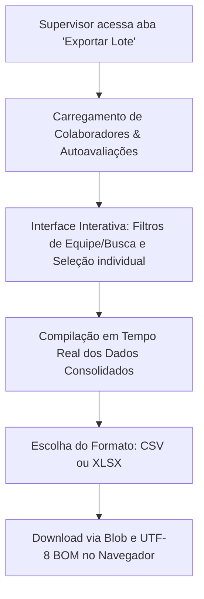

# Exportação de Dados em Lote (Equipe)

Este documento detalha o funcionamento técnico, o design da interface e a arquitetura da ferramenta de exportação em lote de dados de equipe no **FEED-TRACK**.

---

## 🚀 Visão Geral e Arquitetura

A ferramenta de exportação em lote foi projetada para permitir que o supervisor consolide e extraia dados críticos de performance de múltiplos colaboradores simultaneamente. Diferente da exportação individual em PDF, esta ferramenta foca em dados estruturados nos formatos **CSV (separado por vírgulas)** e **Excel (XLSX mockado, separado por ponto e vírgula)**.

O relatório consolidado unifica três pilares de dados do FEED-TRACK:
1. **Médias de Clima & Competências**: Notas agregadas de autoavaliações trimestrais.
2. **Progresso de PDIs**: Métricas de evolução das metas individuais.
3. **Histórico de Feedbacks / 1:1s**: Quantitativo de alinhamentos e assinaturas pendentes.

---

## 📂 Estrutura de Arquivos e Componentes

A implementação está distribuída nos seguintes arquivos principais:

* **Componente de UI**: [`BatchExport.tsx`](file:///c:/Users/LIBERTY.TEC020462/Downloads/feed-track/src/components/supervisor/BatchExport.tsx)
  Interface administrativa interativa para filtrar, selecionar colaboradores e configurar as seções de dados a serem incluídas no relatório.
* **Serviço de Exportação**: [`exportService.ts`](file:///c:/Users/LIBERTY.TEC020462/Downloads/feed-track/src/services/exportService.ts)
  Lógica de geração de strings estruturadas (CSV/XLSX), conversão de formatos de decimais (ponto para vírgula no padrão Excel em português) e tratamento de download de arquivo.
* **Integração no Painel**: [`SupervisorDashboard.tsx`](file:///c:/Users/LIBERTY.TEC020462/Downloads/feed-track/src/components/supervisor/SupervisorDashboard.tsx)
  Inclusão do novo menu lateral ("Exportar Lote"), controle de abas e fornecimento dos estados globais de colaboradores e feedbacks.

---

## 🛠️ Detalhes de Implementação

### 1. Compilação de Métricas (Mapeamento de Dados)

Ao selecionar colaboradores na tabela de visualização prévia, os dados são compilados dinamicamente no hook `useMemo` de `BatchExport.tsx`:

* **Média Geral de Clima**: Calcula a média aritmética das competências comportamentais (*Comunicação*, *Trabalho em Equipe*, *Proatividade*, *Comprometimento*) e técnica (*Conhecimento Técnico*) extraídas de todas as autoavaliações preenchidas do colaborador.
* **Taxa de Conclusão do PDI**:
  $$\text{Taxa de Conclusão (\%)} = \left( \frac{\text{Metas Concluídas}}{\text{Total de Metas}} \right) \times 100$$
* **Volume de Feedbacks / 1:1s**: Quantifica feedbacks classificados por tipo (*Positivo* ou *Desenvolvimento*) e identifica feedbacks pendentes de assinatura pelo colaborador (status *pending*).

### 2. Formatos de Exportação Suportados

Para garantir compatibilidade com diferentes softwares de análise (Python, Excel, PowerBI), o serviço gera dois formatos baseados em texto plano enriquecido:

* **CSV Estruturado (Padrão)**: 
  * Separador de campos: `,` (vírgula).
  * Codificação: UTF-8 com sinalizador BOM (`\uFEFF`) para preservar caracteres acentuados.
  * Ideal para integrações com ferramentas de Business Intelligence ou scripts automatizados.
* **XLSX Mockado (Compatibilidade com Excel em Português)**:
  * Separador de campos: `;` (ponto e vírgula).
  * Conversão de decimais: O caractere `.` (ponto) das médias é convertido para `,` (vírgula).
  * Codificação: UTF-8 com sinalizador BOM (`\uFEFF`).
  * Evita o problema clássico do Excel de agrupar todo o conteúdo na primeira coluna quando aberto diretamente em sistemas configurados em Português do Brasil.

---

## 🎨 Interface Interativa do Supervisor

A interface do painel oferece alta interatividade e facilidade de operação:

1. **Configuração Dinâmica**: Permite desativar pilares específicos (como Clima ou PDI) para exportar um arquivo mais enxuto.
2. **Seleção Inteligente**: Checkboxes individuais integrados a um botão de "Selecionar Todos" ou "Desmarcar Todos", afetando apenas os registros visíveis pós-filtragem.
3. **Filtro Rápido e Busca**: Filtro por time (*Back-office*, *Teleservice*) integrado a uma barra de pesquisa textual (busca por nome ou cargo).
4. **Visualização Prévia**: Tabela reativa que exibe uma prévia em tempo real das médias gerais e metas de PDI dos colaboradores antes de efetivar o download.
