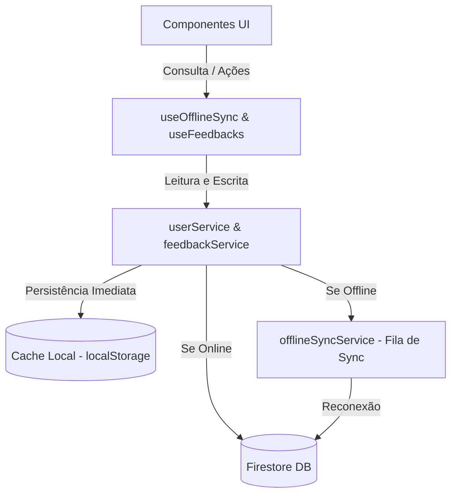

# Sincronização Offline e Cache Local Robusto

Este documento detalha o design, a arquitetura e a implementação das capacidades offline integradas no **FEED-TRACK**.

---

## 1. Visão Geral

Para garantir uma experiência rica e ininterrupta para supervisores e técnicos, o sistema foi equipado com um mecanismo de sincronização offline e cache local robusto. Quando a conexão de rede oscila ou cai, a aplicação continua totalmente operacional:
- Dados novos ou alterados são exibidos imediatamente no painel local através do cache no `localStorage`.
- Operações de escrita são enfileiradas de forma durável em uma fila de sincronização (`sync queue`).
- Uma sincronização em segundo plano é ativada de forma totalmente transparente no momento em que a conexão é restaurada.

---

## 2. Arquitetura e Componentes

A solução é composta por três camadas principais:



### 2.1. Monitor de Conexão e Fila de Sincronização (`offlineSyncService.ts`)
O serviço central de sincronização monitora ativamente o status de rede utilizando:
1. Eventos nativos `window.onLine` e `window.offLine`.
2. Um resolvedor de ping ativo (`checkConnection()`) que realiza requisições rápidas do tipo `HEAD` ao servidor para confirmar a real trafegabilidade de rede, evitando falsos positivos de conectividade.
3. Um temporizador periódico a cada 10 segundos que tenta processar a fila caso o navegador reporte estar conectado.

### 2.2. Ações de Sincronização Suportadas
A interface `SyncAction` encapsula as ações em fila com a seguinte assinatura:
```typescript
export interface SyncAction {
  id: string;
  timestamp: number;
  type: 'addFeedback' | 'updateFeedbackStatus' | 'createUser' | 'updateUser' | 'submitSelfAssessment';
  payload: any;
}
```
As ações em fila são persistidas no `localStorage` sob a chave `feed_track_sync_queue`, garantindo que não sejam perdidas caso a aba do navegador seja fechada.

---

## 3. Fluxo de Operações

### 3.1. Operações de Escrita (ex: Criar Feedback, Atualizar Status, PDI, Badges)
1. O serviço salva os novos dados imediatamente no cache local (`localStorage`), atualizando o estado visual do usuário de maneira instantânea.
2. O serviço verifica se o status atual da conexão é **Online**.
3. Se estiver online e não for o modo mock, tenta realizar a operação diretamente no Firestore. Se falhar por erro de rede, ou se estiver offline, a ação correspondente é enfileirada no `offlineSyncService`.
4. Uma vez online, o `offlineSyncService` varre a fila em ordem cronológica de registro, executa as chamadas de rede no Firestore e limpa a fila após cada operação bem-sucedida.

### 3.2. Operações de Leitura (Sincronização do Cache)
1. Se a rede estiver ativa, os serviços buscam as informações em tempo real no Firestore.
2. Ao receber os dados do Firestore, o serviço de cache faz um merge inteligente: substitui entradas locais desatualizadas ou insere novas chaves, mantendo a cópia em cache 100% atualizada.
3. Se a rede estiver inativa, o sistema realiza o fallback automático para a cópia em cache local, garantindo que o painel exiba as últimas informações disponíveis em vez de quebrar ou carregar indefinidamente.

---

## 4. Indicador de Conexão Premium

Para sinalizar o estado atual da rede de forma elegante e sutil, foi desenvolvido um componente indicador na barra superior (`Header.tsx`):

- **Conectado (Online):** 
  - Exibe um pequeno crachá verde semi-transparente com o texto `"Conectado"`.
  - Contém um pequeno ponto verde pulsante (utilizando animação `ping` do TailwindCSS) simulando atividade constante de rede.
- **Modo Offline:**
  - Exibe um indicador na cor âmbar contendo a mensagem `"Offline - Salvando Localmente"`.
  - Mostra o ícone de `WifiOff` e um contador dinâmico (badge) com o número de alterações pendentes de sincronização (`pendingCount`), gerando transparência e confiança.
- **Sincronizando (Syncing):**
  - Exibe um ícone de rotação contínua (`RefreshCw` com `animate-spin`) e a mensagem `"Sincronizando..."` enquanto repete as ações acumuladas da fila no banco remoto.

---

## 5. Como Testar a Funcionalidade

1. **Simulando Modo Offline:**
   - Abra as Ferramentas do Desenvolvedor no navegador (Chrome, Edge, etc.).
   - Vá para a aba **Rede (Network)** e selecione a opção **Offline**.
   - O indicador na barra superior mudará instantaneamente para `"Offline - Salvando Localmente"`.
2. **Executando Ações Offline:**
   - Crie um novo feedback para um técnico ou altere o progresso de um objetivo do PDI.
   - Note que o painel atualiza instantaneamente com o novo estado. O contador no indicador de conexão exibirá a quantidade de ações pendentes (ex: `1`).
3. **Restaurando a Conexão:**
   - Desative a simulação de modo offline (mude de volta para **No throttling** / **Online**).
   - O indicador mostrará brevemente a animação de rotação `"Sincronizando..."` enquanto transmite os registros offline para o Firebase/Mock.
   - O indicador retornará para o estado verde `"Conectado"`.
