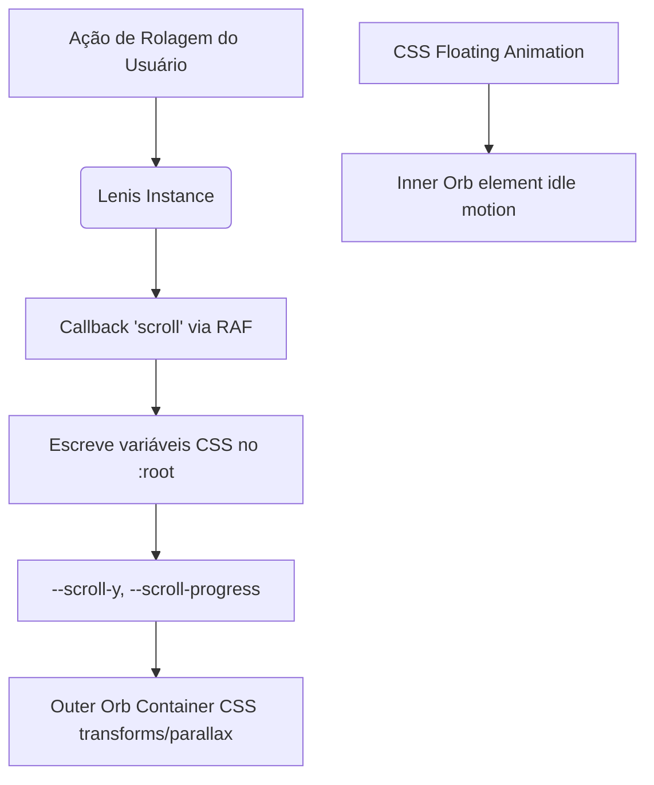

# Integração de Smooth Scroll & Sincronização de Orbes

Este documento detalha o design, a integração e as otimizações de performance aplicadas no sistema de rolagem suave (Smooth Scroll) e na animação responsiva dos orbes de fundo no **FEED-TRACK**.

---

## 🚀 Visão Geral e Arquitetura

Para obter uma rolagem fluida de nível premium e manter o desempenho em **60 FPS estáveis**, adotamos a biblioteca **Lenis** acoplada a um hook customizado React (`useSmoothScroll`). 

A sincronização com as transições dos orbes de fundo foi projetada para evitar renderizações desnecessárias do React. Em vez de utilizar estados do React disparados a cada pixel rolado, a sincronização é conduzida diretamente através de **CSS Custom Properties (Variáveis CSS)** injetadas no elemento raiz `:root`.



---

## 🛠️ Implementação do Hook `useSmoothScroll`

O hook foi projetado para ser flexível. Ele suporta tanto a rolagem global da janela (`window`) quanto rolagem dentro de contêineres específicos (`overflow-y-auto`), como a área principal do painel do supervisor.

O hook está localizado em: `src/hooks/useSmoothScroll.ts`

```typescript
import { useState, useCallback, useEffect, useRef } from 'react';
import Lenis from 'lenis';

export interface UseSmoothScrollProps {
  enabled?: boolean;
}

export function useSmoothScroll(enabled: boolean = true) {
  const [wrapper, setWrapper] = useState<HTMLElement | null>(null);
  const [content, setContent] = useState<HTMLElement | null>(null);
  const lenisRef = useRef<Lenis | null>(null);

  const wrapperRef = useCallback((node: HTMLElement | null) => {
    if (node !== null) setWrapper(node);
  }, []);

  const contentRef = useCallback((node: HTMLElement | null) => {
    if (node !== null) setContent(node);
  }, []);

  useEffect(() => {
    if (!enabled) return;

    const lenis = new Lenis({
      wrapper: wrapper || undefined,
      content: content || undefined,
      duration: 1.2,
      easing: (t) => Math.min(1, 1.001 - Math.pow(2, -10 * t)), // easeOutExpo
      smoothWheel: true,
      wheelMultiplier: 1.0,
      touchMultiplier: 1.2,
    });

    lenisRef.current = lenis;
    const scrollTarget = document.documentElement;

    const handleScroll = (e: any) => {
      const scrollY = e.scroll ?? 0;
      const progress = e.progress ?? 0;
      const velocity = e.velocity ?? 0;

      // Injeta valores dinâmicos no elemento raiz sem forçar reflow/repaint do React
      scrollTarget.style.setProperty('--scroll-y', `${scrollY}`);
      scrollTarget.style.setProperty('--scroll-progress', `${progress}`);
      scrollTarget.style.setProperty('--scroll-velocity', `${velocity}`);
    };

    lenis.on('scroll', handleScroll);

    let rafId: number;
    const raf = (time: number) => {
      lenis.raf(time);
      rafId = requestAnimationFrame(raf);
    };
    rafId = requestAnimationFrame(raf);

    // Valores iniciais padrão
    scrollTarget.style.setProperty('--scroll-y', '0');
    scrollTarget.style.setProperty('--scroll-progress', '0');
    scrollTarget.style.setProperty('--scroll-velocity', '0');

    return () => {
      cancelAnimationFrame(rafId);
      lenis.off('scroll', handleScroll);
      lenis.destroy();
      lenisRef.current = null;
    };
  }, [enabled, wrapper, content]);

  return { wrapperRef, contentRef, lenisRef };
}
```

---

## 🎨 Sincronização e Parallax Otimizado dos Orbes

### O Desafio
Os orbes possuem animações continuadas e flutuantes (`animate-float-slow` / `animate-float-medium`) baseadas em CSS keyframes que alteram propriedades de `transform`. Se atualizássemos a rolagem no mesmo nó DOM, a rolagem cancelaria ou criaria conflitos com a animação de flutuação natural.

### A Solução
Adotamos uma abordagem de **dois níveis (wrapping)**:
1. **Container Externo (Outer Container)**: Controla a tradução de parallax e a opacidade vinculadas diretamente à rolagem via expressões CSS `calc(var(--scroll-y) * factor)`.
2. **Elemento Interno (Inner Orb)**: Executa a animação contínua e suave de flutuação em idle.

Isso garante que o movimento contínuo não pare, enquanto a interação física de rolagem do usuário empurra a perspectiva do orbe suavemente.

Exemplo de markup utilizado nos dashboards:

```tsx
{/* Orbe Top-Right sincronizado com smooth scroll */}
<div 
  className="absolute top-[-10%] right-[-10%] w-[600px] h-[600px] pointer-events-none"
  style={{
    transform: 'translate3d(calc(var(--scroll-y, 0) * -0.05px), calc(var(--scroll-y, 0) * 0.08px), 0)',
    opacity: 'calc(1 - var(--scroll-progress, 0) * 0.45)',
    willChange: 'transform, opacity'
  }}
>
  <div className="w-full h-full bg-primary/5 rounded-full blur-[140px] animate-float-slow" />
</div>
```

---

## ⚡ Otimizações de Desempenho

1. **Zero React Re-renders na Rolagem**: Como o hook atualiza diretamente o estilo em linha através do `:root` (`document.documentElement`), o React não renderiza novamente nenhuma parte da interface durante a rolagem. Isso previne perda de quadros.
2. **Propriedade `will-change`**: Adicionada aos contêineres de orbes que sofrem transformações baseadas na rolagem para instruir o navegador a renderizá-los em camadas separadas de composição da GPU.
3. **Decoupled Animation Engine**: Separar as animações de flutuação em idle (CPU/GPU-friendly CSS transition/keyframes) das dinâmicas de rolagem (Lenis + GPU compositor) permite uma experiência incrivelmente leve mesmo em telas de alta taxa de atualização (120Hz+).
4. **Deceleração Elástica com Easing customizado**: O easing matemático `easeOutExpo` fornece um efeito suave e elástico no final da rolagem, resultando em um feedback tátil virtual refinado.
